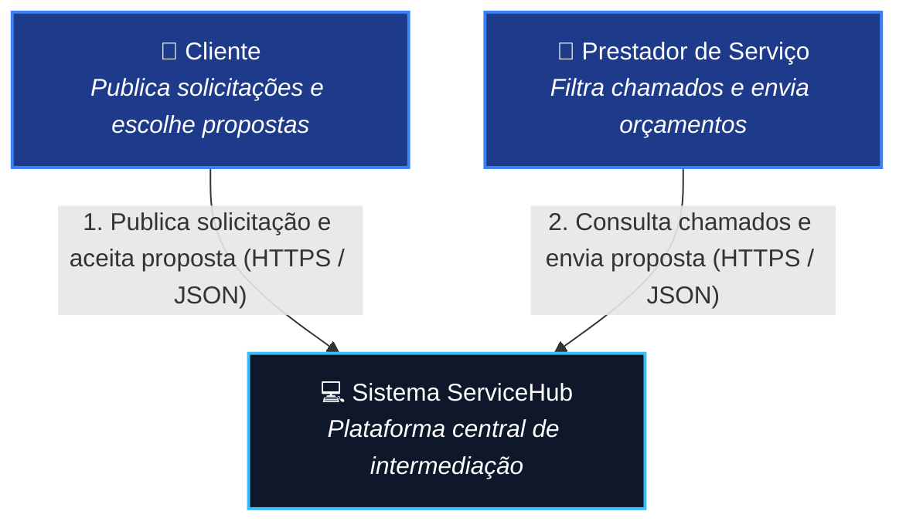
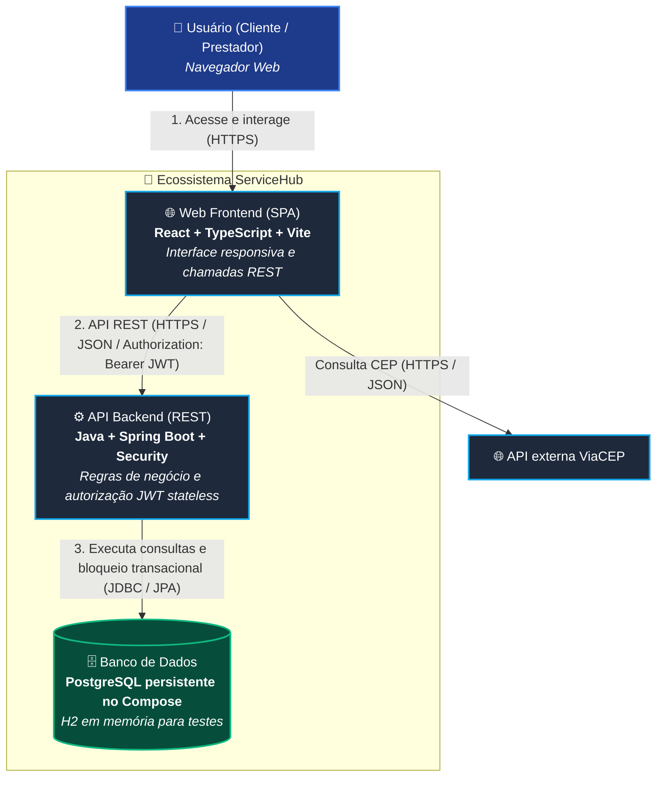

# Arquitetura Efetiva de Software — ServiceHub

**Marco:** Entrega 7 - Sprint 3 (revisão da implementação atual)

**Data da revisão:** 18 de Novembro de 2026

**Status da Arquitetura:** Implementada / Efetiva  

---

## 1. Escopo e Contexto do Sistema

O **ServiceHub** é uma aplicação web desenvolvida no modelo de arquitetura Cliente-Servidor (*Client-Server*) para a intermediação e gestão de serviços autônomos na região de São José e Grande Florianópolis[cite: 62].

A arquitetura divide a solução em uma **Aplicação de Página Única (SPA)** no frontend e uma **API REST** no backend, conectada a persistência relacional. As chamadas protegidas usam JWT stateless no cabeçalho `Authorization: Bearer`; o Compose usa PostgreSQL com volume persistente e a execução direta/testes usam H2 em memória.

---

## 2. Modelo C4 - Diagramas de Arquitetura

O modelo C4 foi adotado para documentar a estrutura do sistema em múltiplos níveis de abstração.

### 2.1 Nível 1: Diagrama de Contexto do Sistema (System Context)

#### Descrição das Interações:
* **Cliente $\rightarrow$ ServiceHub:** O cliente autentica-se na plataforma, cadastra seu endereço e publica uma solicitação de serviço. Em seguida, visualiza as propostas enviadas e escolhe a ideal.
* **Prestador $\rightarrow$ ServiceHub:** O prestador autentica-se, filtra chamados por especialidade, envia orçamentos e acessa os dados de contato após o aceite.

---

### 2.2 Nível 2: Diagrama de Contêineres (Containers)

## 3. Descrição dos Componentes e Responsabilidades

O diagrama de classes das entidades, serviços e repositórios implementados está
em [Diagrama de Classes do Backend](./diagramas/Diagrama-de-Classes.md).

* **Web Frontend (`ServiceHub/src`):**
  * **Módulo de Autenticação (`Login.tsx`, `Cadastro.tsx`):** Formulários com validação de perfil.
  * **Dashboards (`DashboardCliente.tsx`, `DashboardPrestador.tsx`):** Visões para criação de chamados, cartões de serviços e listagem de propostas.
  * **Cliente API (`src/servicos/api.ts`):** Centraliza chamadas REST e acrescenta `Authorization: Bearer <token>` obtido do armazenamento do navegador.
  * **Consulta de CEP (`src/servicos/cep.ts`):** Consulta diretamente a API pública ViaCEP, normaliza a resposta para o modelo de endereço e a utiliza no fluxo de cadastro de endereço. Não há integração direta com a API dos Correios no código atual.
  * **Edição de perfil (`ModalPerfilUsuario.tsx`):** Modal React reutilizado nos dashboards de cliente e prestador. Recebe dados e callbacks por props; as telas chamadoras controlam o salvamento e acionam o cliente da API, mantendo o componente desacoplado da persistência.

* **API Backend (`back-end/src`):**
  * **Segurança (`SecurityConfig.java`):** Configura Spring Security stateless com `SessionCreationPolicy.STATELESS`, validação JWT de Bearer token pelo Resource Server e BCrypt para senhas. O filtro efetivo para Bearer é `BearerTokenAuthenticationFilter`; não há configuração de autenticação HTTP Basic via `BasicAuthenticationFilter`.
  * **Controladores (`controller/`):** Expõe os endpoints REST (`/api/usuarios`, `/api/solicitacoes`, `/api/propostas`).
  * **Serviços (`service/`):** Encapsulam as regras de negócio de usuários, endereços, solicitações e propostas; operações concorrentes usam transações e bloqueio quando necessário.
  * **Repositório (`repository/`):** Interfaces Spring Data JPA estendendo `JpaRepository`.

### Autenticação e logout

O endpoint de login valida as credenciais e `JwtTokenService` emite um JWT assinado com expiração de uma hora. O frontend armazena o token na chave `token` do `localStorage` e o envia nas chamadas protegidas pelo cabeçalho `Authorization: Bearer`. As requisições são autenticadas individualmente, sem sessão HTTP de usuário.

No logout, o frontend chama `/api/usuarios/logout` e remove o token do armazenamento local. O backend limpa o `SecurityContext` da requisição atual, mas não mantém blacklist nem revoga o JWT emitido; o token ainda pode ser usado até expirar.

### Fluxo de endereço e perfil

No cadastro de endereço, o frontend valida e normaliza o CEP e consulta `https://viacep.com.br/ws/{cep}/json/`. Os campos retornados pelo ViaCEP são convertidos para o modelo de endereço usado pela interface; CEP inexistente ou falha da consulta é tratado no fluxo de formulário. O backend persiste os dados do endereço, mas não faz chamada à API de CEP.

`ModalPerfilUsuario` é uma interface reutilizada por ambos os dashboards. O modal cuida dos campos, edição e validação visual e recebe `onSalvar` como callback; os componentes de página executam a atualização via cliente REST. Assim, a apresentação do perfil não depende diretamente do backend.

---

## 4. Diferenças entre a Arquitetura Planejada vs. Efetiva

Para fins de transparência acadêmica na Entrega 7, registram-se os ajustes feitos em relação ao planejamento inicial do projeto:

1. **Modelo de Contratação (Regra de Negócio):** 
   - *Planejado:* O aceite do prestador vinculava o serviço imediatamente.
   - *Efetivo:* Introduziu-se a entidade `PropostaServico`. O prestador envia um orçamento e o cliente escolhe a proposta desejada antes de alterar o status para `EM_ANDAMENTO`.

2. **Banco de Dados (Infraestrutura):**
   - *Planejado:* Execução em PostgreSQL via Docker.
   - *Efetivo no repositório:* o Compose declara PostgreSQL com volume persistente e parametriza
     as propriedades JDBC; H2 permanece como fallback para execução direta e testes.

3. **Integração com Gateway de Pagamento (Asaas):** 
   - *Planejado:* Pagamento integrado no MVP.
   - *Efetivo:* A decisão técnica está registrada na ADR-0002, mas a integração com o Asaas não está implementada no código atual.
---

## 5. Apoio da Arquitetura ao MVP

A arquitetura Cliente-Servidor em camadas garante desacoplamento:
* A API Spring Boot isola a validação das regras de negócio e permissões.
* O controle transacional assegura que chamados não recebam propostas duplicadas nem aceites simultâneos.
