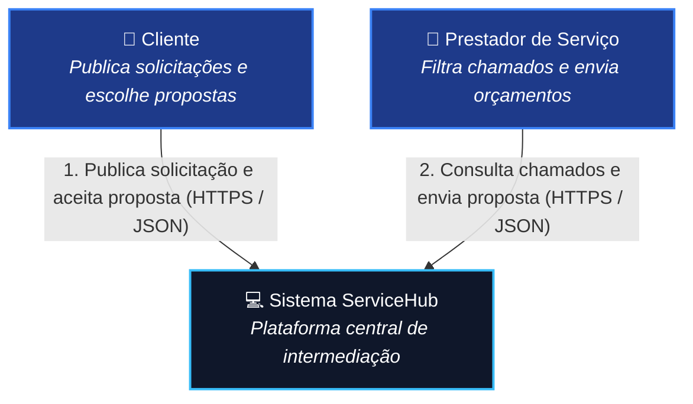
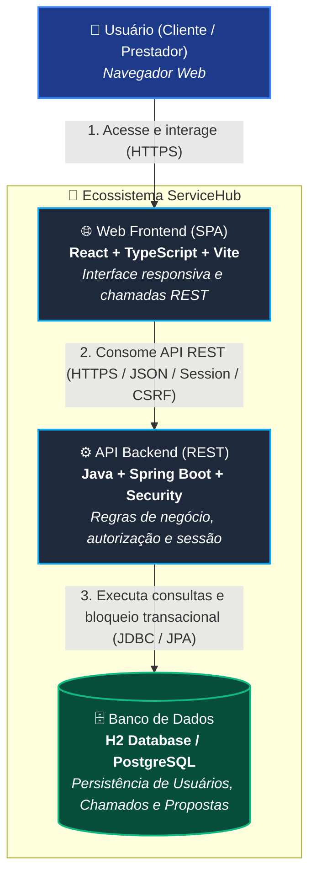

# Arquitetura Efetiva de Software — ServiceHub

**Marco:** Entrega 7 - Sprint 3  
**Data:** 22 de Outubro de 2026  
**Status da Arquitetura:** Implementada / Efetiva  

---

## 1. Escopo e Contexto do Sistema

O **ServiceHub** é uma aplicação web desenvolvida no modelo de arquitetura Cliente-Servidor (*Client-Server*) para a intermediação e gestão de serviços autônomos na região de São José e Grande Florianópolis[cite: 62].

A arquitetura divide a solução em uma **Aplicação de Página Única (SPA)** no front-end e uma **API RESTful** no back-end, conectada a uma camada de persistência relacional e securitizada por controle de sessão e tokens de segurança.

---

## 2. Modelo C4 - Diagramas de Arquitetura

O modelo C4 foi adotado para documentar a estrutura do sistema em múltiplos níveis de abstração.

### 2.1 Nível 1: Diagrama de Contexto do Sistema (System Context)

#### Descrição das Interações:
* **Cliente $\rightarrow$ ServiceHub:** O cliente autentica-se na plataforma, cadastra seu endereço e publica uma solicitação de serviço. Em seguida, visualiza as propostas enviadas e escolhe a ideal.
* **Prestador $\rightarrow$ ServiceHub:** O prestador autentica-se, filtra chamados por especialidade, envia orçamentos e acessa os dados de contato após o aceite.

---

### 2.2 Nível 2: Diagrama de Contêineres (Containers)

## 3. Descrição dos Componentes e Responsabilidades

* **Web Frontend (`ServiceHub/src`):**
  * **Módulo de Autenticação (`Login.tsx`, `Cadastro.tsx`):** Formulários com validação de perfil.
  * **Dashboards (`DashboardCliente.tsx`, `DashboardPrestador.tsx`):** Visões para criação de chamados, cartões de serviços e listagem de propostas.
  * **Cliente API (`/servicos/api.ts`):** Módulo centralizador de requisições que utiliza o padrão *Adapter*.

* **API Backend (`back-end/src`):**
  * **Segurança (`SecurityConfig.java`):** Configura a autenticação por sessão HTTP, BCrypt, CORS e CSRF (`SpaCsrfTokenRequestHandler` aplicando o padrão *Strategy*).
  * **Controladores (`controller/`):** Expõe os endpoints REST (`/api/usuarios`, `/api/solicitacoes`, `/api/propostas`).
  * **Serviços (`SolicitacaoServicoService.java`):** Lógica de negócio central. Valida o proprietário, o estado `SOLICITADO` e aplica transação com bloqueio no banco.
  * **Repositório (`repository/`):** Interfaces Spring Data JPA estendendo `JpaRepository`.

---

## 4. Diferenças entre a Arquitetura Planejada vs. Efetiva

Para fins de transparência acadêmica na Entrega 7, registram-se os ajustes feitos em relação ao planejamento inicial do projeto:

1. **Modelo de Contratação (Regra de Negócio):** 
   - *Planejado:* O aceite do prestador vinculava o serviço imediatamente.
   - *Efetivo:* Introduziu-se a entidade `PropostaServico`. O prestador envia um orçamento e o cliente escolhe a proposta desejada antes de alterar o status para `EM_ANDAMENTO`.

2. **Banco de Dados (Infraestrutura):** 
   - *Planejado:* Execução em PostgreSQL via Docker.
   - *Efetivo:* Uso do banco em memória (H2) na Sprint 3 para agilizar a execução dos testes automatizados no CI. A migração para PostgreSQL será realizada na Sprint 4.

3. **Integração com Gateway de Pagamento (Asaas):** 
   - *Planejado:* Pagamento integrado no MVP.
   - *Efetivo:* A decisão técnica está registrada na ADR-0002, mas a implementação dos endpoints do Asaas foi postergada para a Sprint 4 para priorizar a estabilização do fluxo de propostas.
---

## 5. Apoio da Arquitetura ao MVP

A arquitetura Cliente-Servidor em camadas garante desacoplamento:
* A API Spring Boot isola a validação das regras de negócio e permissões.
* O controle transacional assegura que chamados não recebam propostas duplicadas nem aceites simultâneos.
