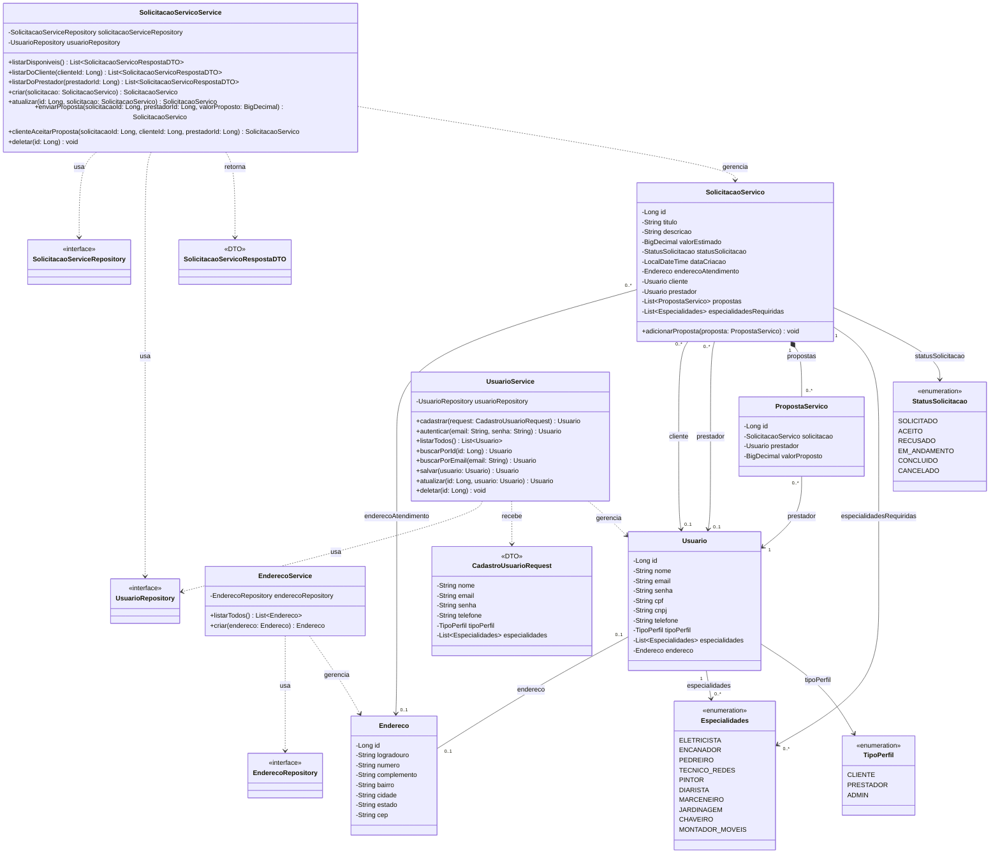

# Diagrama de Classes do Backend

O diagrama representa as entidades, enums, serviços e repositórios implementados
em `back-end/src/main/java/com/es/servicehub`. Os métodos exibidos são os
principais pontos de entrada dos serviços; getters e setters gerados pelo Lombok
foram omitidos.

Cada `PropostaServico` pertence a uma solicitação e a um prestador. O backend
também restringe a uma proposta por combinação de solicitação e prestador. Ao
aceitar uma proposta, o serviço associa o prestador escolhido à solicitação e
atualiza seu valor estimado e status.
